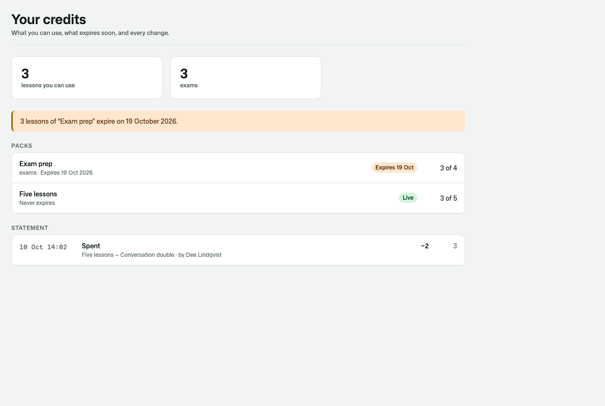
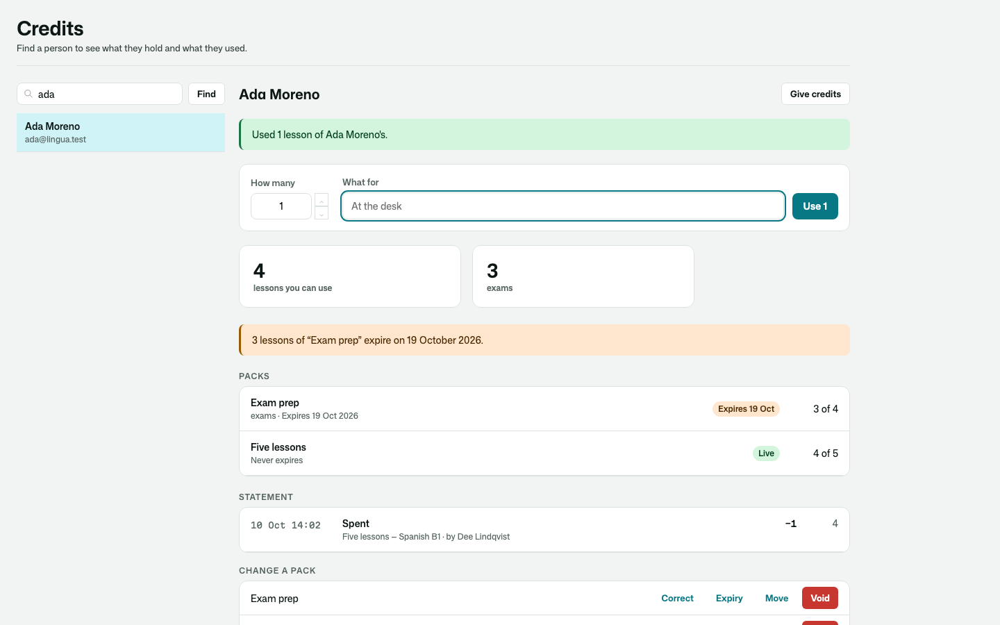
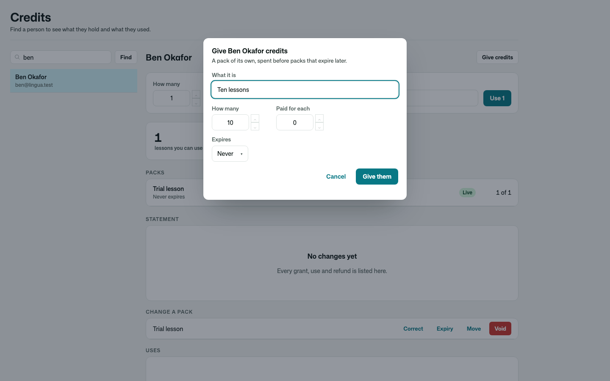
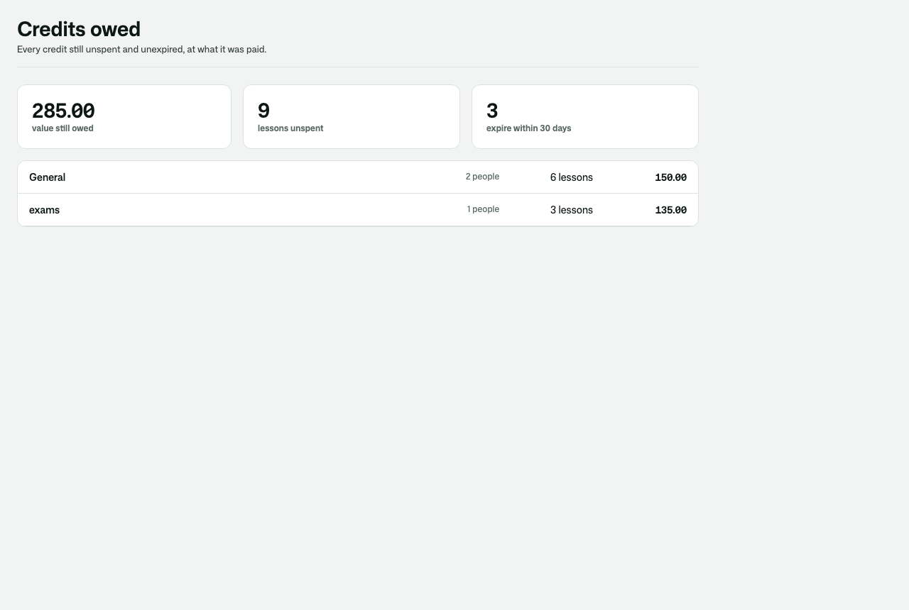
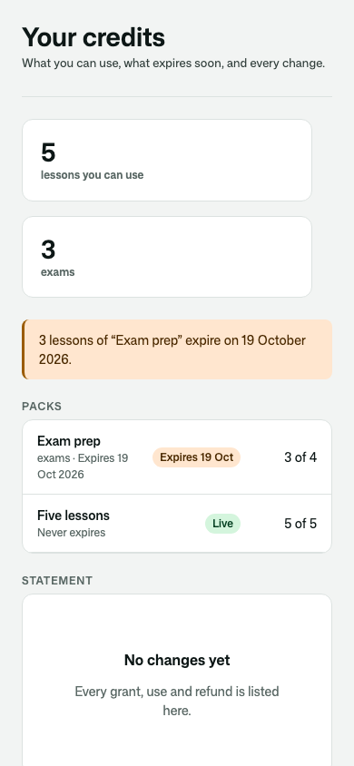
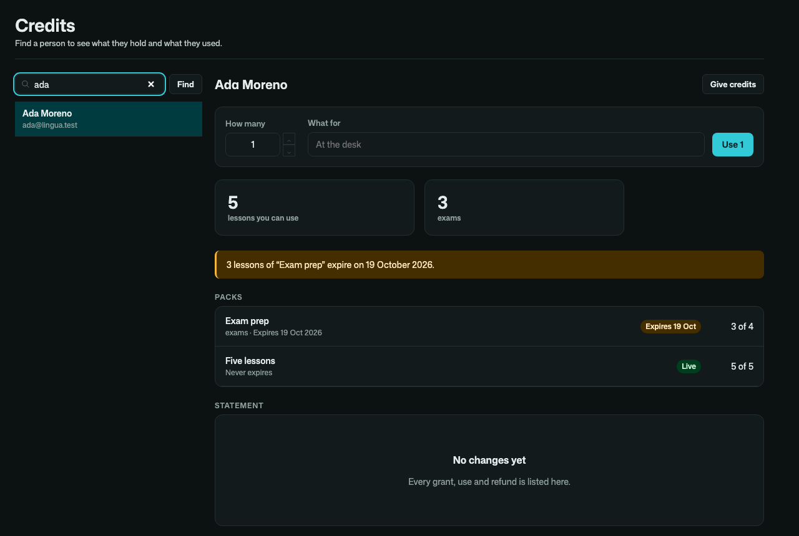

# Osysharp.PrepaidCredits

**Prepaid uses, kept as a ledger.** A class pack, a ten-visit card, a bundle of machine hours, prepaid lessons, print
credits: anything sold — or given — as a number of uses.

- **Packs of credits** granted to a person — optionally expiring, optionally **scoped** to one purpose ("workshops"),
  each with what a credit was paid, idempotent per reference (an order line grants once, however often the payment
  notice arrives).
- **Spending** from the pack that **expires first** (one that never expires goes last), across packs when one holds too
  few, **all or nothing and never below zero** — once per reference, however many tries race. A spend can be undone; each
  credit goes back to the pack it came from.
- **Who spends**: the desk for anybody; a member for themself when the app allows it (an online booking); a parent for a
  child who never signs in, through the app's answer to who acts for whom.
- **Staff changes with a reason**: correct a balance, change or end an expiry, void a pack, move credits to another
  person — every one kept.
- **A statement the holder reads**: every grant, use, refund, correction, expiry and move, with the balance after it and
  who did it.
- **Notices**: before a pack expires, when a balance runs low, when it runs out — as events the app turns into mail.
- **The value still owed**: unspent, unexpired credits by scope, at what they were paid — prepaid value still owed in
  service.

| Your credits | The desk |
|---|---|
|  |  |

| Giving a pack | The value still owed |
|---|---|
|  |  |

| On a phone | In the dark |
|---|---|
|  |  |

## Use it

```osy
// app.osy
use Osysharp.Identity@0;
use Osysharp.PrepaidCredits@0;
```

```osy
using Osysharp.Identity;
using Osysharp.PrepaidCredits;

policy ManagesCredits => IsOwner;      // grant, correct, extend, end, void, move — and the value owed
policy SpendsCredits => IsDesk;        // spend and undo for anybody
policy SpendsOwnCredits => IsMember;   // a member spends their own (optional)

app.Credits = new CreditsSetup { ExpiryNoticeDays = 14, LowBalanceAt = 2, Unit = "class", Units = "classes" };

// When an order is paid — the order line as the reference, so a repeated notice grants nothing twice:
GrantCredits(customer, 10, "Ten classes", DateTime.UtcNow.AddMonths(6), reference: "order-1041-1", unitValue: 12m);

// When a class is booked:
var spend = SpendCredits(member, 1, "Tuesday yoga", "booking:" + booking.Id);
if (spend == null) { /* not enough credits — nothing was spent */ }
```

From code: `CreditsLeft(person)`, `CreditStatementOf(person)`, `RefundSpend(spend)`, `AdjustCredits(pack, 3, "why")`,
`ExtendCredits(pack, date)`, `ExpireCredits(pack)`, `VoidCredits(pack)`, `TransferCredits(pack, 2, other)`,
`CreditLiabilities()`. Events: `CreditsGranted`, `CreditsSpent`, `CreditsRefunded`, `CreditsRunningLow`,
`CreditsRanOut`, `CreditsExpiringSoon`, `CreditsExpired`, `CreditsVoided`, `CreditsAdjusted`, `CreditsTransferred`.

## Pages

`/credits` (the signed-in person), `/staff/credits` (the desk) and `/staff/credits/owed` (the value owed) are served in
the app's working shell, in its theme. Take one over by declaring a component of the same name, or place
`CreditsOverview`, `CreditsDesk` or `CreditsOwed` on a page of your own.

## Every balance is a ledger

A pack's balance changes only inside the kit's functions, and each change writes its line — nobody, staff included,
writes a balance directly, edits a line or deletes one. Each pack has a life of its own that tells its holder before it
expires and expires what is left into the ledger.

## Personal data

What a use or a change was for is classified personal content. In an app with Osysharp.Privacy,
Osysharp.Privacy.PrepaidCredits arrives by itself: a person's packs, uses and ledger are in their copy of their data
and are erased when they ask.

## What informed it

- **Orb** — credits as blocks with their own expiry; drawing down the soonest-expiring block first; a ledger of typed
  entries (increment, decrement, expiry change, expiry, void); alerts when a balance drops or runs out.
- **Stripe Billing credit grants** — credits scoped to what they may pay for; voiding a grant.
- **Glofox and Mindbody** — class packs and credit packs sold with an expiry from purchase, one credit per booking.
- **ClassPass** — a class that costs more than one credit, which is why a spend takes an amount.

## Source

[github.com/osysharp/prepaidcredits](https://github.com/osysharp/prepaidcredits). Its tests (`tests/`) are a language
school's: every behaviour above, each seam shown, and the pages under `osy test --pixels`.

## Examples

Taken from this package's own tests, which compile and run on every release.

```osy
using Osysharp.Identity;
using Osysharp.UserAccounts;
using Osysharp.PrepaidCredits;

[Test(School)]
[runas(Ola)]
void CreditsGranted_is_heard_once_per_pack_not_per_repeat() {
  GrantCredits(Ada, 4, "Four lessons", reference: "order-9");
  GrantCredits(Ada, 4, "Four lessons", reference: "order-9");
  Background.Settle();
  Assert.Equal(1, Heard.Count(h => h.Event == "granted" && h.Detail == "Four lessons"));
}
```

From [`tests/events.test.osy`](tests/events.test.osy).

```osy
using Osysharp.Identity;
using Osysharp.UserAccounts;
using Osysharp.PrepaidCredits;
using Osysharp.Workflow;

[Test(School)]
[runas(Ola)]
void the_holder_is_told_two_weeks_before_and_the_rest_expires_into_the_ledger() {
  var pack = GrantCredits(Ada, 5, "Spring term", DateTime.UtcNow.AddDays(30));
  runas(Dee) { SpendCredits(Ada, 2, "Two lessons", "v1"); }
  Workflow.Settle(pack);
  TestClock.Advance(TimeSpan.FromDays(15));         // the notice is 14 days before: not yet
  Workflow.Settle(pack);
  Background.Settle();
  Assert.Equal(0, HeardCount("expiring"));
  TestClock.Advance(TimeSpan.FromDays(2));
  Workflow.Settle(pack);
  Background.Settle();
  Assert.Equal(1, HeardCount("expiring"));
  Assert.Equal(1, CreditsExpiringWithin(Ada, 14).Count);
  TestClock.Advance(TimeSpan.FromDays(14));
  Workflow.Settle(pack);
  Background.Settle();
  Assert.Equal(0, CreditsLeft(Ada));
  var p = CreditPack.Single(x => x.Id == pack.Id);
  Assert.Equal(3, p.ExpiredCredits);
  Assert.Equal(CreditPackState.Ended, p.State);
  var line = CreditStatementOf(Ada).First();
  Assert.Equal(CreditEntryKind.Expired, line.Kind);
  Assert.Equal(-3, line.Change);
  Assert.Null(line.By);
  Assert.Equal(1, Heard.Count(h => h.Event == "expired" && h.Detail == "Spring term:3"));
}
```

From [`tests/expiry.test.osy`](tests/expiry.test.osy).

```osy
using Osysharp.Identity;
using Osysharp.UserAccounts;
using Osysharp.PrepaidCredits;

[Test(School)]
[runas(Ola)]
void the_owner_grants_a_pack_and_the_holder_can_spend_it() {
  var pack = GrantCredits(Ada, 10, "Ten lessons", unitValue: 28m);
  Assert.Equal(10, pack.Remaining);
  Assert.Equal(10, CreditsLeft(Ada));
  Assert.Equal(0, CreditsLeft(Ben));
  var line = CreditStatementOf(Ada).Single();
  Assert.Equal(CreditEntryKind.Granted, line.Kind);
  Assert.Equal(10, line.Change);
  Assert.Equal(10, line.BalanceAfter);
  Assert.Equal(Ola.Id, line.By.Id);
}
```

From [`tests/ledger.test.osy`](tests/ledger.test.osy).

## Learn more

- [The Osysharp.PrepaidCredits reference](https://osysharp.com/reference/ui/prepaid-credits-kit/)
- [Osysharp.PrepaidCredits in the package catalogue](https://osysharp.com/packages/#osysharp-prepaidcredits)
- [The Osy# reference](https://osysharp.com/reference/) — the language, the runtime and every kit
- [`llms-full.txt`](https://osysharp.com/llms-full.txt) — the whole reference and specification as one Markdown file, for a coding agent

## Licence

MIT — see [`LICENSE`](LICENSE).
